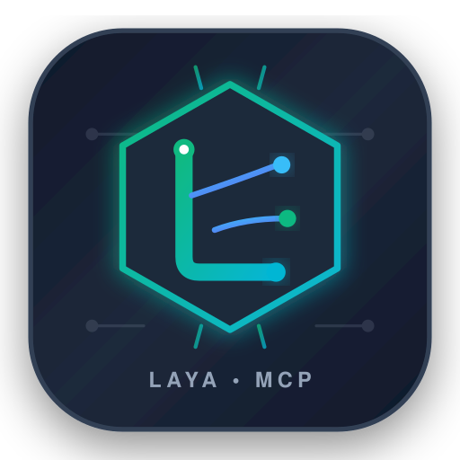

<p align="center">
   &nbsp;
  <a href="https://aisq.science/"><picture>
    <source media="(prefers-color-scheme: dark)" srcset="assets/Light_Logo_name.png">
    
  </picture></a>
</p>
<h1 align="center">LAYA MCP SERVER</h1>
<p align="center">
  
  <a href="LICENSE"></a>
  
  
  
</p>

**Model quyết định chạy CPU cho AI agent.** Một container, một model, một lệnh setup.
Có MCP, REST, Swagger và giao diện test. Không GPU, API trả phí, database hoặc chia dev/prod.

Tác giả **[htrnguyen](https://www.htrnguyen.id.vn/)** · [English](README.md)

## CHẠY

Cần **Linux/systemd, Docker Compose v2+, Python 3 và [uv](https://docs.astral.sh/uv/getting-started/installation/)**.
Chạy bằng user thường có quyền sudo; không thêm sudo trước lệnh dưới.
Lần đầu tải thư viện/model. Mặc định giới hạn 4 CPU, 4 GiB RAM, không swap.

```bash
./setup.sh
```

Script bật Docker lúc boot, chạy service, test MCP và đăng ký global cho Claude Code, Codex, OpenCode tìm thấy.
Sau đó mở phiên agent mới. Global áp dụng mọi project của cùng user trên máy này.

| Chức năng | URL |
|---|---|
| Test, copy rule/settings | **http://127.0.0.1:30765/** |
| Swagger | http://127.0.0.1:30765/docs |
| MCP HTTP | http://127.0.0.1:30765/mcp |
| Health | http://127.0.0.1:30765/health |

Chỉ đăng ký lại agent: `./setup.sh --register-only`.
Chọn target: thêm `--targets codex,claude`; xem trước: `./setup.sh --dry-run`.
Installer giữ các MCP khác, backup trước khi sửa và không tạo trùng.
Skill liên kết tới folder project, vì vậy không di chuyển/xóa checkout sau cài.

## SỬ DỤNG

> Đọc laya_guide, dùng laya_decide phân loại “Tôi bị trừ tiền hai lần và cần hoàn tiền”.
> Truyền caller/task và hiển thị kết quả tool thật.

| Tool | Công dụng |
|---|---|
| `laya_guide` | Đọc schema, giới hạn, hướng dẫn; không inference |
| `laya_status` | Model, thiết bị, revision |
| `laya_decide` | 1–3 câu hỏi có kiểu dữ liệu, output chuẩn hóa |
| `laya_classify` | Giữ cách phân loại đơn cũ |

Choice chọn 2–10 nhãn. Noul trả xác suất đúng/sai. Score chấm theo các mô tả có thứ tự,
**còn thử nghiệm**. Noul/score luôn cần xem lại. Để nhanh, ưu tiên input ngắn và một câu hỏi.

REST mới: `POST /v1/decide`; REST raw cũ: `/v1/systemone`.
Trang test/Swagger có ví dụ. Agent đọc tài liệu qua `/llms.txt`, `/guide.md`, `/skill.md`, `/rules.md`,
`/integrations.json`, `/openapi.json` hoặc MCP resource `laya://guide`.

## CẤU HÌNH, LOG VÀ DỮ LIỆU

Sửa `.env` rồi chạy lại setup. Mặc định nằm trong [.env.example](.env.example).

```bash
sudo docker compose ps
sudo docker compose logs -f --tail 50
sudo docker compose stop
sudo docker compose start
sudo docker compose down       # giữ model đã tải
```

**Chỉ log trong Docker**, không ghi thêm file log của ứng dụng.
`LAYA_LOG_FORMAT=compact` hiện kết quả/thời gian/caller/task/trace; đổi thành `json` để xem input/output,
rồi setup lại. Docker xoay log 10 MiB × 2 file. Recreate container có thể mất log cũ.
Không cộng thời gian MCP với request REST lồng bên trong.

**Giữ `data/models`** để không tải lại weights. Cache setup, reports và backup cấu hình đều được ignore.
Setup dọn log file cũ sau khi triển khai thành công. `restart: always` chỉ áp dụng khi container còn tồn tại;
sau `compose down` cần setup/up lại.

## GIỚI HẠN VÀ KIỂM TRA

Chỉ dùng local, không có xác thực; không public cổng ra LAN/Internet.
Log JSON có thể chứa văn bản riêng tư. Xác suất cao không đảm bảo đúng, không thay test, phép tính hay phân quyền.
Input/output bị cắt hoặc sai schema sẽ bị API chuẩn hóa từ chối. Model này không viết code hay suy luận nhiều bước.

```bash
uv run --no-project --with-requirements tests/requirements.txt python -m unittest discover -s tests -v
sudo docker compose exec -T laya python /app/scripts/verify_mcp.py
python3 scripts/benchmark.py --runs 100
```

Smoke test cũ trên Ryzen 5 5600H, 4 threads: p50 **103 ms**, p95 **116 ms** với sáu mẫu ngắn lặp lại.
Không coi đây là cam kết chất lượng/tốc độ chung hoặc kết quả API nhiều câu hỏi mới.

## NGUỒN VÀ GIẤY PHÉP

Xem [nguồn đầy đủ](README.md#sources--license): Laya/Convai Innovations, MCP SDK, FastAPI,
PyTorch, Transformers, Swagger UI, Docker và uv. Bài Jev chỉ là tham khảo kiến trúc.

Tác giả tích hợp: **htrnguyen** · [Apache-2.0](LICENSE) · [NOTICE](NOTICE) · [CHANGELOG](CHANGELOG.md).
Project không thuộc TypeSafe, không phân phối Jev hoặc khẳng định chất lượng tương đương.
