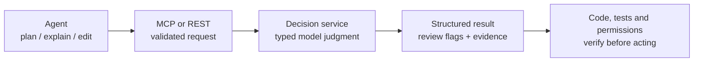
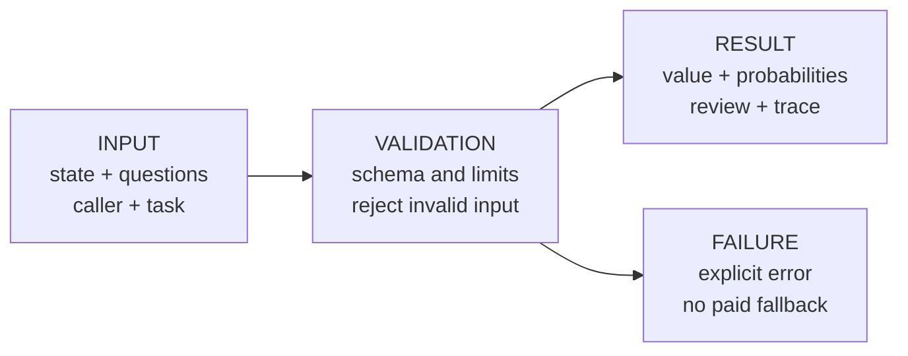
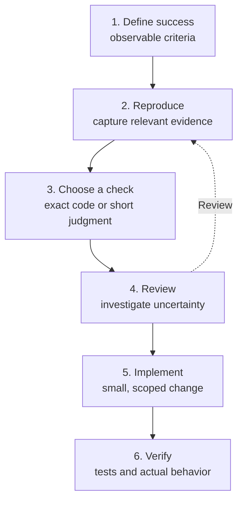
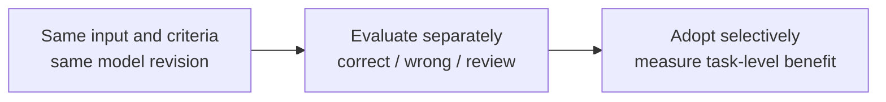
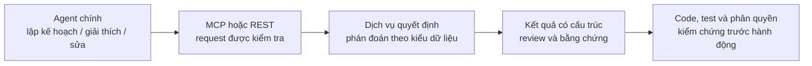
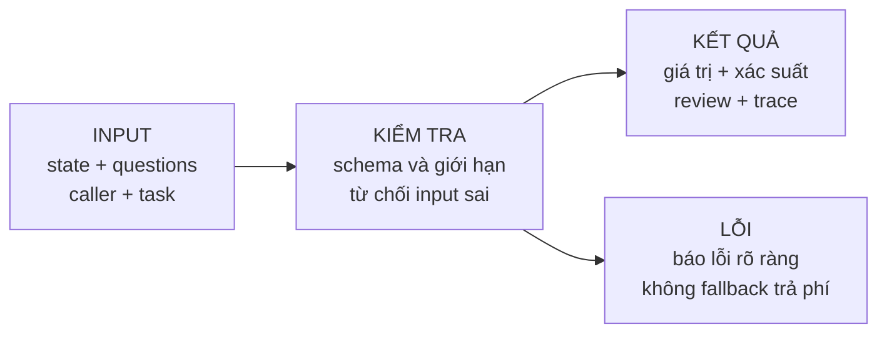
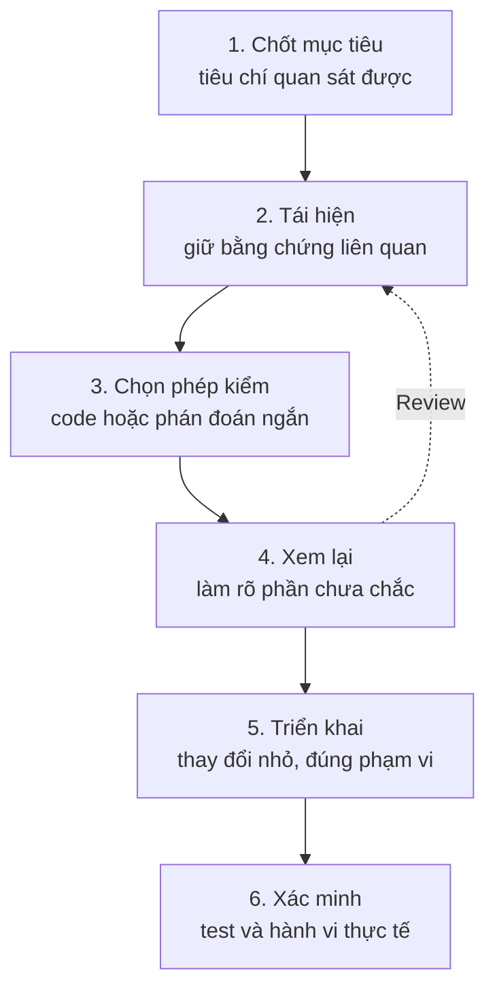
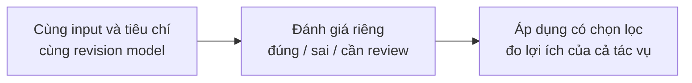

# EDITABLE DIAGRAM SOURCES

The report uses native TikZ figures. These Mermaid equivalents support reuse in Markdown-based documentation.

## EN / 1

## EN / 2

## EN / 3

## EN / 4

## VI / 1

## VI / 2

## VI / 3

## VI / 4

